  
  
  
  

<a href="https://mrzroot.github.io/page-smash/">Website and live demo</a> · <a href="#فارسی">فارسی</a> · <a href="CHANGELOG.md">Changelog</a> · <a href="CONTRIBUTING.md">Contributing</a>

# Page Smash

Bored of a web page? Click the Page Smash button and a small jetpack character flies onto the current tab. Aim with the
mouse and break the page's text and pictures into pieces that fall and bounce with real physics. It is a toy: nothing
is sent anywhere, the real site is not changed, and reloading the tab brings everything back.

## Quick start

1. Download or clone this repository.
2. **Chrome / Edge:** open `chrome://extensions` (or `edge://extensions`), turn on **Developer mode**, click **Load unpacked** and pick the repository folder.
3. **Firefox 128+:** run `bash scripts/pack.sh`, open `about:debugging#/runtime/this-firefox`, click **Load Temporary Add-on** and pick `dist/firefox/manifest.json`.
4. Open any normal `http`/`https` page and click the Page Smash icon.

## Features

- Five weapons: machine gun, gravity gun, flamethrower, laser and black hole (keys `1` to `5`), each with a second mode on right-click.
- Real 2D physics ([Matter.js](https://brm.io/matter-js/), bundled in `vendor/`, no network requests).
- Works on most sites; a live counter shows how much of the page you have smashed.
- `Shift+R` starts the same page again, `Shift+N` jumps to a random Wikipedia page.
- Persian and English on-screen hints.

## Controls

| Key | Action |
| --- | --- |
| `W A S D` or arrow keys | Fly |
| Mouse | Aim |
| Left click / right click | Fire / the weapon's second mode |
| `1` – `5` | Switch weapon |
| `Space` | Dash towards the cursor |
| `Shift+R` | Restart this page |
| `Shift+N` | Random Wikipedia page |

## How it works

When you click the icon, the background script injects `game.js` and `game.css` into the active tab. The game measures
the visible text blocks and images, hides the originals, and replaces each with a physics body drawn in the same place.
Your weapons apply forces to those bodies. Everything happens inside that tab; reloading it restores the page.

## Limits

- It only starts on `http`/`https` pages, not on `chrome://` pages or the extension store.
- CSS background images (pictures that are not their own element) are not smashed.
- Not published in any extension store yet; load it unpacked as above.

## فارسی

**Page Smash** یک افزونه‌ی سرگرمی است. روی دکمه‌اش بزنی، یک آدمک جت‌پک‌دار روی همین صفحه می‌آید و می‌توانی متن و عکس‌های صفحه را با فیزیک واقعی خرد کنی. چیزی به جایی فرستاده نمی‌شود و با بارگذاری دوباره‌ی صفحه همه‌چیز برمی‌گردد.

**نصب در کروم و اج:** صفحه‌ی `chrome://extensions` را باز کن، Developer mode را روشن کن، Load unpacked را بزن و پوشه‌ی همین مخزن را انتخاب کن.

**نصب در فایرفاکس (۱۲۸ به بالا):** دستور `bash scripts/pack.sh` را اجرا کن، صفحه‌ی `about:debugging#/runtime/this-firefox` را باز کن و فایل `dist/firefox/manifest.json` را با Load Temporary Add-on بارگذاری کن.

**کلیدها:** `WASD` یا جهت‌ها برای حرکت، ماوس برای نشانه‌گیری، کلیک چپ شلیک و کلیک راست حالت دوم، `۱` تا `۵` عوض کردن سلاح (مسلسل، گرانش، شعله‌افکن، لیزر، سیاه‌چاله)، `Space` برای جهش، `Shift+R` شروع دوباره و `Shift+N` یک صفحه‌ی تصادفی ویکی‌پدیا.

پس‌زمینه‌های CSS خرد نمی‌شوند. این پروژه کد، طراحی و اسم Page Rage را کپی نکرده و به سازنده‌اش وابسته نیست.

## Contributing

Ideas and bug reports are welcome in [issues](../../issues/new/choose). See [CONTRIBUTING.md](CONTRIBUTING.md).

## License

MIT, see [LICENSE](LICENSE). Matter.js is MIT-licensed by its authors. This is an original project and is not affiliated with Page Rage.
